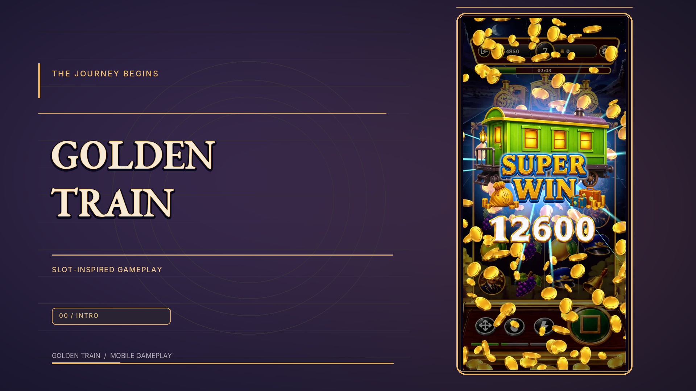
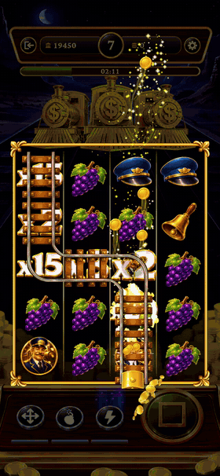
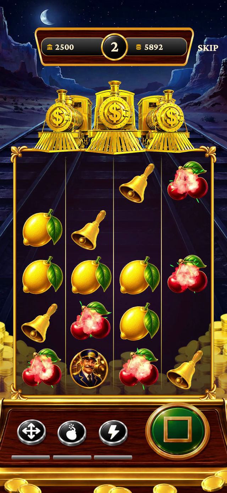
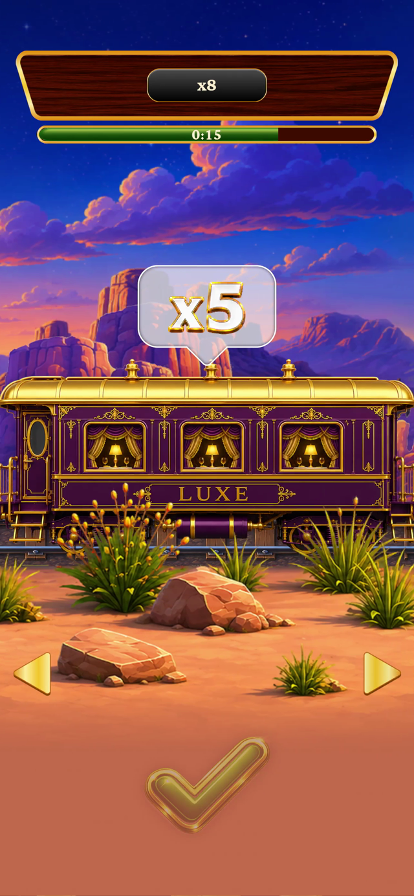
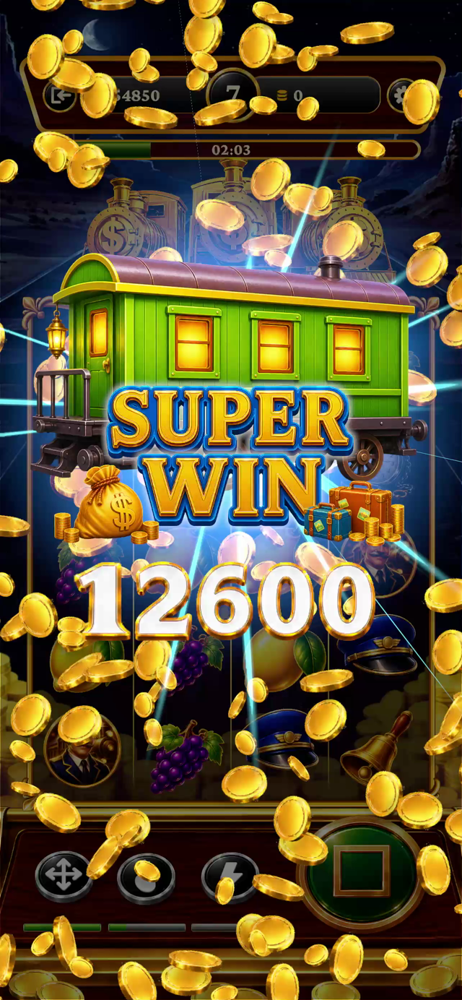
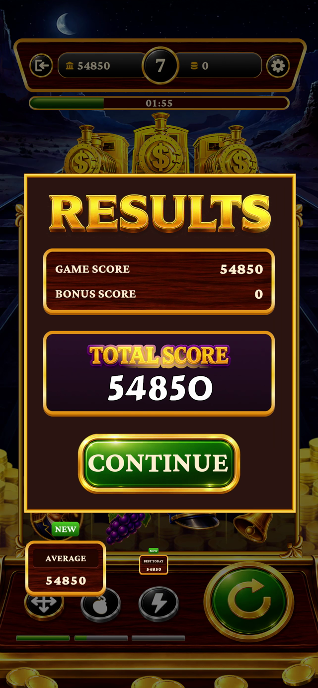

# Golden Train

### Slot-inspired mobile puzzle game with cascading wins and train-themed bonus rounds

**Unity** · **C#** · **VContainer** · **URP** · **UniTask**

*Spin the symbols. Trigger cascades. Chase the next big win.*

[**▶ Watch the Gameplay Trailer**](https://github.com/EmilUnityDev/GoldenTrain/releases/tag/v1.0.0-portfolio) &nbsp;·&nbsp; [**Explore the Architecture**](docs/ARCHITECTURE.md) &nbsp;·&nbsp; [**Gameplay Preview**](#gameplay-preview)

Click the cover to view the 43-second trailer on the Portfolio Showcase release page.

## Overview

**Golden Train** is a mobile, slot-inspired puzzle game built around spins, **cascading symbols**, scoring combinations, and bonus rounds. Instead of manually swapping pieces as in traditional match-3, the player triggers a spin; matching symbols are removed and new symbols fall into their places, potentially starting another win without an additional spin.

The game combines the central slot-style loop with active skills, a train-themed multiplier bonus game, tutorials, progression, and UI-driven rewards.

> **Portfolio context:** This is an offline adaptation of a commercially developed **team project**. It demonstrates its gameplay and technical structure; it does not imply sole authorship of every script or asset.

## Gameplay preview

  

### Core gameplay loop

**SPIN → SYMBOL COMBINATIONS → CASCADE → MORE WINS → TOTAL WIN**

- **Spin-driven gameplay** — A state-based spin loop controls spinning, stopping, calculation, and result handling.
- **Cascading wins** — Matched symbols disappear; the board drops and refills symbols, allowing additional winning sequences during the same spin.
- **Scoring & multipliers** — Paytable and winning-symbol calculations feed a dedicated score service, with bonus score handling and win presentation.
- **Active skills** — Gameplay abilities can influence the symbols and board during a run.
- **Train-themed bonus round** — The *Luxury Wagons* minigame awards multipliers as players reveal wagons.
- **Progression** — Tutorial, collection, currency, daily quests, and menu interfaces connect the rounds into a larger mobile game experience.

## Screenshots

<table>
  <tr>
    <td align="center" width="25%"></td>
    <td align="center" width="25%"></td>
    <td align="center" width="25%"></td>
    <td align="center" width="25%"></td>
  </tr>
  <tr>
    <td align="center"><strong>Cascades</strong></td>
    <td align="center"><strong>Bonus round</strong></td>
    <td align="center"><strong>Super Win</strong></td>
    <td align="center"><strong>Results</strong></td>
  </tr>
</table>

## Engineering highlights

| Area | Implementation |
| --- | --- |
| **Spin state machine** | `IdleState`, `SpinningState`, `StoppingState`, `CalculationState`, and `WinState` coordinate the main gameplay cycle. |
| **Board & winning logic** | Symbol generation, a configurable match threshold, paytable lookup, and repeated drop/refill cycles are handled in separate components. |
| **Game architecture** | VContainer lifetime scopes manage project-, menu-, and gameplay-level dependencies. |
| **Scoring** | The score service tracks spin, bonus, and high scores, and exposes events for UI updates. |
| **Bonus systems** | Train-themed *Luxury Wagons* bonus gameplay is implemented separately from the slot board. |
| **UI and persistence** | Popup, overlay, scene navigation, local data storage, and progression services support the gameplay loop. |
| **Offline adaptation** | Local match management and on-device score storage replace the former external tournament integration. |

### Code worth exploring

- [`SpinSystem.cs`](Assets/SpinSystem/SpinSystem.cs) — orchestrates the spin state machine.
- [`CalculationState.cs`](Assets/SpinSystem/States/CalculationState.cs) — win calculation, cascading drop/refill, and related flow.
- [`SlotGameManager.cs`](Assets/SlotsLogic/Match3Slots/Scripts/Core/SlotGameManager.cs) — board configuration, symbol generation, and dependency wiring.
- [`ScoreService.cs`](Assets/Game/Scripts/Services/Score/ScoreService.cs) — score aggregation, multipliers, and score events.
- [`LuxuryWagonsBonusGame.cs`](Assets/Game/Scripts/MiniGame/LuxuryWagonsBonusGame.cs) — bonus wagon mechanics and multiplier handling.
- [`ProjectLifetimeScope.cs`](Assets/Game/Scripts/Game/GameRoot/ProjectLifetimeScope.cs) — shared service registration.
- [`LocalMatchManager.cs`](Assets/Game/Scripts/Gameplay/LocalMatch/LocalMatchManager.cs) — local match completion in the portfolio edition.

See the [Architecture Overview](docs/ARCHITECTURE.md) for the broader scene flow and module responsibilities.

## Tech stack

`Unity 2023.2` · `C#` · `URP 16` · `VContainer` · `UniTask` · `Unity UI` · `ScriptableObjects`

## Run locally

1. Clone the repository and open its root directory with **Unity Hub**.
2. Use **Unity 2023.2.22f1** (recorded in `ProjectSettings/ProjectVersion.txt`) and let the packages import. The manifest includes **URP 16.0.6**.
3. Open [`Assets/Game/Scenes/Boot.unity`](Assets/Game/Scenes/Boot.unity) and press **Play**.
4. The boot flow opens the tutorial for a fresh profile, or the main menu for a returning one.
5. Start a local round, trigger a spin, and complete the session to view the result.

> **Note:** Third-party packages and art may require their original licenses. This project has been play-tested locally after removing former company integrations, but a fresh import may require dependency setup on a new machine.

## About this portfolio edition

The original project was created in a professional team environment. For this version, external tournament, attribution, and company-specific integrations were removed or replaced with local behavior to make the gameplay demonstrable offline.

**Authorship & licensing:** The project is presented as a portfolio reference, not as a claim of sole authorship. Third-party assets and plugins remain subject to their original licenses. No open-source license is granted for the complete repository.
