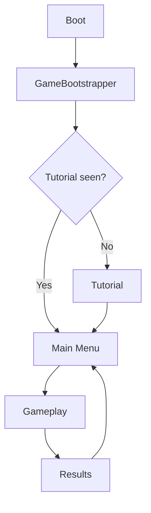
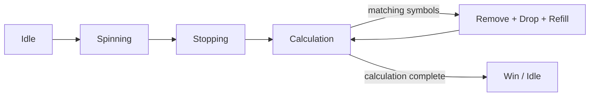

# Golden Train — Architecture Overview

This document outlines the primary game code paths observed in the offline portfolio edition. It is a practical navigation map for engineering review, not a claim of authorship.

## 1. Scene and dependency organization

The application is organized around Boot, Tutorial, MainMenu, and Gameplay scenes:

- [`GameBootstrapper`](../Assets/Game/Scripts/Game/GameRoot/GameBootstrapper.cs) decides where to navigate on startup based on the tutorial flag.
- [`ProjectLifetimeScope`](../Assets/Game/Scripts/Game/GameRoot/ProjectLifetimeScope.cs) registers shared dependencies and services via VContainer.
- [`MainMenuLifetimeScope`](../Assets/Game/Scripts/Game/MainMenu/Root/MainMenuLifetimeScope.cs) scopes menu-related services.
- [`GameLifetimeScope`](../Assets/Game/Scripts/Game/Gameplay/Root/GameLifetimeScope.cs) scopes gameplay-related services.
- [`SceneService`](../Assets/Game/Scripts/Game/GameRoot/Services/Scenes/SceneService.cs) manages scene transitions.

## 2. Spin and cascade pipeline

The core game loop is organized in [`SpinSystem`](../Assets/SpinSystem/SpinSystem.cs) with dedicated state objects:

- [`CalculationState`](../Assets/SpinSystem/States/CalculationState.cs) evaluates matches and handles repeated cascades, scoring, and bonus triggers.
- [`SlotGameManager`](../Assets/SlotsLogic/Match3Slots/Scripts/Core/SlotGameManager.cs) constructs the board, match checker, generator, paytable, limits, and spin orchestrator.
- [`Board`](../Assets/SlotsLogic/Match3Slots/Scripts/Core/Board.cs) is the board model; [`BoardView`](../Assets/SlotsLogic/Match3Slots/Scripts/Core/BoardView.cs) provides its presentation.
- [`SymbolCountMatchChecker`](../Assets/SlotsLogic/Match3Slots/Scripts/MatchCheckers/SymbolCountMatchChecker.cs) tests matching symbols against a configurable threshold.
- [`PaytableService`](../Assets/SlotsLogic/Match3Slots/Scripts/Combinations/PaytableService.cs) and [`WinCalculator`](../Assets/SlotsLogic/Match3Slots/Scripts/Core/WinCalculator.cs) participate in win calculations.

The internal folder name `Match3Slots` is historical project organization; player interaction is spin-driven, **not manual tile swapping**.

## 3. Bonus features and skills

- [`LuxuryWagonsBonusGame`](../Assets/Game/Scripts/MiniGame/LuxuryWagonsBonusGame.cs) manages the wagon selection, multipliers, and bonus completion.
- [`SkillsService`](../Assets/SlotsLogic/Match3Slots/Scripts/Core/Skills/SkillsService.cs) coordinates active gameplay skills.
- [`ScoreService`](../Assets/Game/Scripts/Services/Score/ScoreService.cs) manages spin scores, deferred rewards, bonus points, and local high scores.

## 4. UI, saves, and progression

- [`PopupService`](../Assets/Game/Scripts/Game/GameRoot/Services/Popups/PopupService.cs) manages shared popup interactions.
- [`UIOverlayService`](../Assets/Game/Scripts/Game/GameRoot/Services/Overlay/UIOverlayService.cs) controls loading/overlay UI.
- [`GameDataRepository`](../Assets/Game/Scripts/Game/GameRoot/Services/DataStorage/GameDataRepository.cs) and [`PlayerPrefsDataStorage`](../Assets/Game/Scripts/Game/GameRoot/Services/DataStorage/PlayerPrefsDataStorage.cs) handle game state persistence.
- [`DailyQuestService`](../Assets/Game/Scripts/Services/DailyQuests/DailyQuestService.cs) handles quest progression.

## 5. Offline portfolio boundaries

- [`LocalMatchManager`](../Assets/Game/Scripts/Gameplay/LocalMatch/LocalMatchManager.cs) replaces the tournament score submission and uses PlayerPrefs for local match statistics.
- [`LocalAnalyticEventService`](../Assets/Game/Scripts/Game/GameRoot/Services/Analytics/LocalAnalyticEventService.cs) satisfies the analytics abstraction without external attribution.

The source repository includes third-party code and assets that may require further removal or license verification before **public** redistribution. Removing corporate integrations is not sufficient to establish public redistribution rights.
